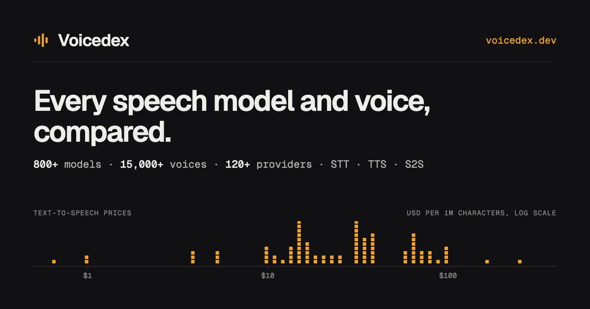
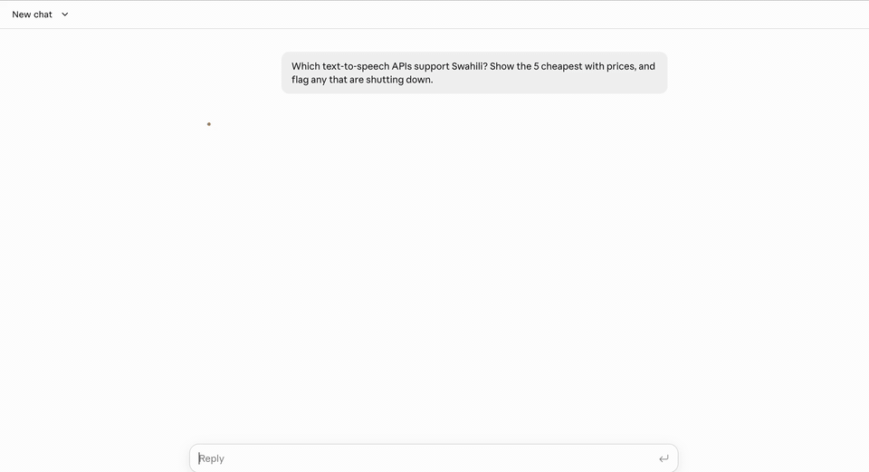

# Voicedex

[](https://voicedex.dev)

**[voicedex.dev](https://voicedex.dev)** is an open catalog of speech AI: speech-to-text,
text-to-speech and speech-to-speech models and voices from 120+ providers, normalized so you can
compare them. For every model it records the supported languages, features, price, regions, streaming
interfaces and shutdown dates. You can browse it on the site, query it with a free REST API, or
download it as one JSON file.

> 800+ models · 15,000+ voices · 120+ providers · synced from provider APIs and docs · versioned in git

## What you can do with it

- **Compare prices across providers.** Text-to-speech is normalized to USD per 1M characters and
  speech-to-text to USD per hour of audio, so one table sorts them all:
  [text-to-speech](https://voicedex.dev/text-to-speech) ·
  [speech-to-text](https://voicedex.dev/speech-to-text) ·
  [speech-to-speech](https://voicedex.dev/speech-to-speech).
- **Find models for a language**, for example
  [Hindi text-to-speech](https://voicedex.dev/text-to-speech/hindi) or
  [Swahili speech-to-text](https://voicedex.dev/speech-to-text/swahili).
- **Filter by feature**, for example
  [speech-to-text with speaker diarization](https://voicedex.dev/speech-to-text/speaker-diarization)
  or [open-source text-to-speech](https://voicedex.dev/text-to-speech/open-source).
- **Listen to voices** across providers, with samples in the language you choose, filtered by use case,
  age, accent and gender: [voices](https://voicedex.dev/voices?preview=1).
- **See what's shutting down** before it breaks your app:
  [scheduled shutdowns](https://voicedex.dev/models?status=ending).
- **Compare models side by side** on languages, features, price, limits and audio formats
  ([compare](https://voicedex.dev/compare)), or two providers head to head
  ([Deepgram vs ElevenLabs](https://voicedex.dev/compare/deepgram-vs-elevenlabs)).
- **See what works with your framework**: providers with a built-in LiveKit, Pipecat, Vapi or Retell
  integration, from each framework's own docs
  ([text-to-speech for Pipecat](https://voicedex.dev/text-to-speech/pipecat),
  [speech-to-text for LiveKit](https://voicedex.dev/speech-to-text/livekit)).
- **Find alternatives** to a provider or a model that's shutting down
  ([ElevenLabs alternatives](https://voicedex.dev/alternatives/elevenlabs)).
- **Estimate monthly cost** at your usage on any model list or model page.
- **Browse every provider** ([providers](https://voicedex.dev/providers)) and
  [which languages each covers](https://voicedex.dev/coverage).
- **Follow what changes**: new models, price changes and shutdowns
  ([changes](https://voicedex.dev/changes), [Atom feed](https://voicedex.dev/changes.xml)), and what speech AI
  costs overall ([pricing report](https://voicedex.dev/reports/speech-ai-pricing)).

## Why trust the data

- **Auditable.** The whole catalog is plain JSON in [`data/`](data/). Every change is a reviewable
  diff, and every model records its source URLs and when it was checked. Price history is
  `git log -p data/*/models.json`.
- **One schema for every provider.** Languages are BCP-47, capabilities and regions use a controlled
  vocabulary, and voices are linked to the models they work with. See [`schema/`](schema/).
- **Nothing invented.** Prices come only from vendor pages and are never converted between currencies.
  Unknown values stay empty instead of guessed. Shutdown dates are taken from the vendor's own
  announcement.
- **History is kept.** Models that disappear upstream are marked deprecated, not deleted, and
  providers that shut down stay listed with the date and the evidence.

## API

Free, read-only, no key needed. Base URL: `https://voicedex.dev`. Interactive reference:
[voicedex.dev/docs](https://voicedex.dev/docs).

```bash
# British English female voices
curl "https://voicedex.dev/v1/voices?language=en-GB&gender=female&limit=5"

# Speech-to-text models with speaker diarization, hosted in the EU
curl "https://voicedex.dev/v1/models?type=stt&capabilities=speaker_diarization&region=eu"

# Everything, in one response
curl -O "https://voicedex.dev/v1/catalog.json"
```

| Path | |
|---|---|
| `GET /v1/providers` · `/v1/providers/{id}` | Providers, with model and voice counts and framework integrations. Filters: `type`, `compliance`, `access`, `headquarters`, `framework` |
| `GET /v1/providers/{id}/models` · `/models/{model_id}` | Filters: `type`, `language`, `capabilities`, `lifecycle`, `region`, `realtime`, `open_weights`, `recommended`, `shutting_down`, `max_price_usd`, `framework`, `search`; `sort` = `name`, `price` or `newest` |
| `GET /v1/providers/{id}/voices` · `/voices/{voice_id}` | Filters: `gender`, `category`, `language`, `model`, `accent`, `use_case`, `age`, `has_sample`, `multilingual`, `capabilities`, `search` |
| `GET /v1/models` · `/v1/voices` | The same filters across all providers, plus `provider` |
| `GET /v1/catalog.json` | Everything in one response, deprecated records included |

Responses carry an `ETag`, so you can poll cheaply with `If-None-Match`. List endpoints also support
`updated_since` and `limit`/`offset`. Public ids are stable across deploys.

For LLMs and AI agents there is [`/llms.txt`](https://voicedex.dev/llms.txt), a plain-Markdown map
of the site and the data.

## MCP server



Give AI assistants the whole catalog over the [Model Context Protocol](https://modelcontextprotocol.io):
`https://voicedex.dev/mcp` (Streamable HTTP, free, no key, read-only). Setup for each client is at
[voicedex.dev/mcp](https://voicedex.dev/mcp).

```bash
claude mcp add --transport http voicedex https://voicedex.dev/mcp     # Claude Code
```

Tools: `search_models`, `get_model`, `compare_models` (accepts loose names like "deepgram nova-3"),
`estimate_cost` (workload or voice-agent pipeline, maths done server-side), `find_alternatives` (replacements
for a model, e.g. one shutting down), `search_voices`, `list_providers`, `recent_changes`. Every result carries
its price source, check dates and a voicedex.dev link; missing prices come with the reason.
Ask things like "Which text-to-speech APIs support Swahili, cheapest first?" or "Which speech models shut
down in the next 90 days?".

## How the data is kept fresh

Each provider has a syncer in [`voicedex/sync/`](voicedex/sync/). It calls the provider's API where
one exists, and otherwise extracts the data from the provider's documentation. Open-weights models are
synced from the Hugging Face Hub. `scripts/sync.py` then merges the result into `data/`:

- New records are added; unchanged records keep their dates.
- Records that disappeared upstream are marked deprecated, never deleted.
- A guard refuses to write if a fetch looks partial.

The diff is reviewed in a pull request, and merging to `main` deploys it.

```bash
uv sync --extra dev --extra sync
uv run python scripts/sync.py deepgram            # dry-run, prints a per-field diff
uv run python scripts/sync.py deepgram --write    # updates data/deepgram/
uv run python scripts/validate.py                 # schema and consistency checks (CI runs this too)
uv run python scripts/catalog_health.py           # what's stale, broken or due for a re-sync
```

## Run locally

```bash
uv sync --extra dev
uv run uvicorn voicedex.main:app --reload --port 8001
uv run pytest
```

## Contributing

Spotted a wrong price, a missing model or a provider we don't cover?
[Open an issue](https://github.com/chandradot99/voicedex/issues) with a link to the vendor's page,
or send a pull request.

- To add a provider, follow the checklist in [`CLAUDE.md`](CLAUDE.md#adding-a-provider).
- Which providers qualify: [`docs/design/provider-expansion.md`](docs/design/provider-expansion.md).
- Architecture: [`docs/design/v2-architecture.md`](docs/design/v2-architecture.md).

## License

Code and data: [Apache 2.0](LICENSE). If you use the data, a link back to
[voicedex.dev](https://voicedex.dev) is appreciated.
